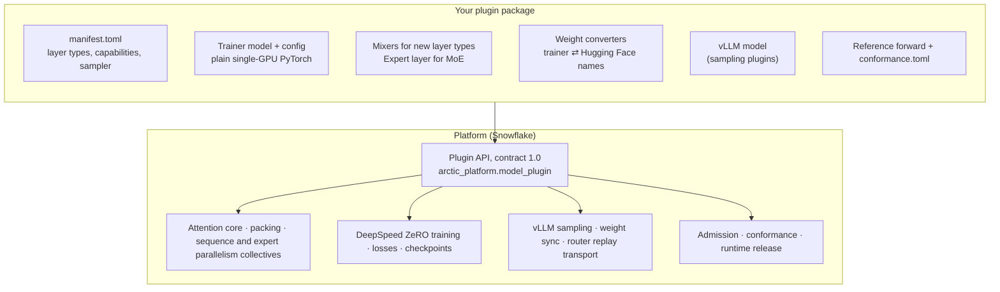
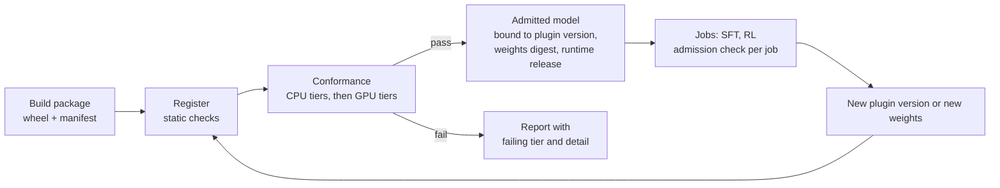
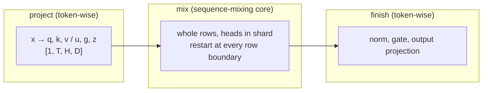
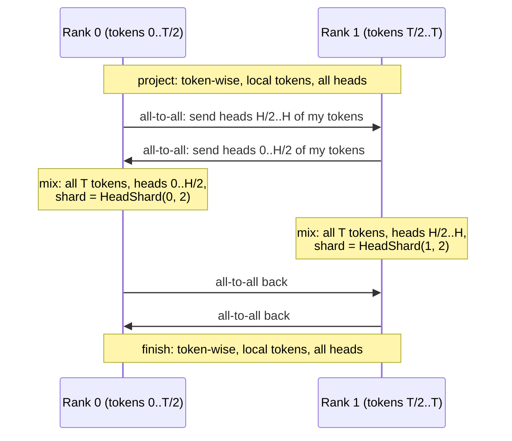
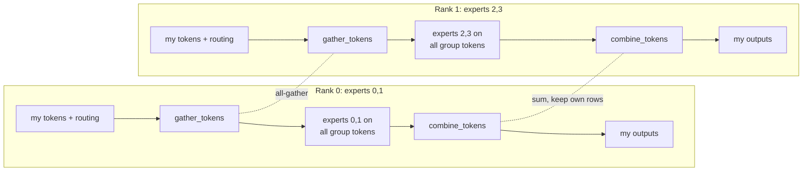
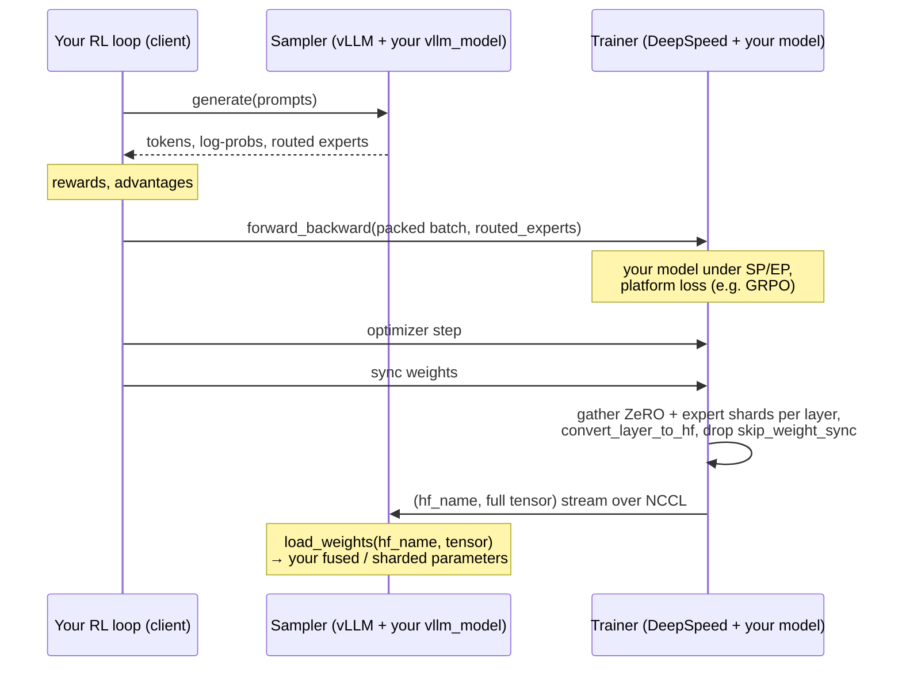
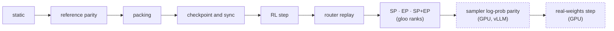
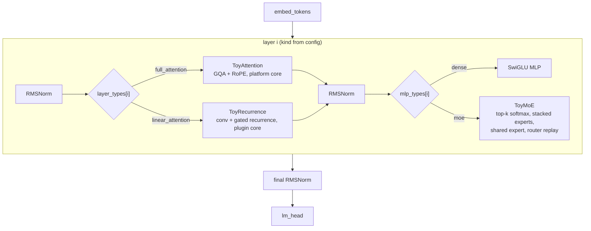

# Model plugins for Cortex Training: specification

| | |
|---|---|
| Status | **Draft for review and sign-off.** Interfaces may change until contract 1.0 is frozen. |
| Contract version | 1.0 (draft) |
| Reference implementation | [`arctic_platform/model_plugin/`](../../arctic_platform/model_plugin/) |
| Example plugin | [`examples/model_plugins/toy_hybrid_moe/`](../../examples/model_plugins/toy_hybrid_moe/) |

This document specifies how you bring a **new model architecture** to Cortex Training as a Python package, a
*model plugin*, and train it with supervised fine-tuning or reinforcement learning on the service's GPUs. It covers
what you write, what the platform does with it, the checks your plugin must pass, and what each side commits to.

The key words **MUST**, **MUST NOT**, **SHOULD** and **MAY** are used as in RFC 2119.

---

## 1. Summary

A model plugin is a Python package that describes one model family to the platform. You write the model as plain,
single-GPU PyTorch: full attention heads, full experts, no `torch.distributed`. The platform then:

- **Finds your model's structure at load time** from your config and module tree, so any layer count or layer order works without code changes.
- **Packs** several sequences into one row, **shards** sequences across GPUs (sequence parallelism) and **shards experts** across GPUs (expert parallelism), using hooks you declare.
- **Trains** it with DeepSpeed ZeRO, the platform's loss functions (SFT, GRPO and others) and its checkpointing.
- **Samples** from it with vLLM for reinforcement learning, and **syncs weights** from the trainer to the sampler after every optimizer step.

Your plugin must pass a **conformance suite** before the service admits it. You can run every CPU tier on a laptop.

---

## 2. Who owns what



| Area | You (plugin author) | Platform |
|---|---|---|
| Model math | The trainer model, its config and a slow reference implementation | Nothing. The platform never changes your math. |
| Attention | Q/K/V and output projections, positional encoding | The attention core (`AttentionModule.mix`), its GPU kernels and its sequence parallelism |
| New layer types | A sequence-mixing core (`mix`) and a `Mixer` that declares how it can be sharded | The head/sequence exchange around your core |
| Mixture of experts | Routing math and expert weights in the stacked layout; an `ExpertLayer` | Token exchange across the expert-parallel group, DeepSpeed gradient grouping, router-replay transport |
| Data layout | Respect packed-row boundaries (`cu_seqlens`) | Packing rows, computing boundaries, splitting sequences across ranks |
| Weights | Converters between trainer and Hugging Face names | Gathering ZeRO and expert shards, checkpoints, streaming weights to the sampler |
| Sampling | A vLLM model that loads Hugging Face-named weights | Running vLLM, sizing caches, weight-sync transport |
| Quality | A reference forward and conformance tolerances | Running conformance at registration, admission checks on every job |

---

## 3. Concepts

| Term | Meaning |
|---|---|
| **Layer type** | The kind of sequence-mixing a decoder layer does, named in the config's `layer_types` list: for example `full_attention` or `linear_attention`. |
| **Mixer** | The object that integrates one layer type with the platform: it claims the layer's modules and makes them sequence-parallel. |
| **Core (`mix`)** | The part of a sequence-mixing layer that mixes information *across tokens*. It always sees whole rows. Projections before and after it work token by token. |
| **Packed batch** | Several sequences concatenated into one row (`[1, T]`). `position_ids` restart at 0 at each row start. |
| **`cu_seqlens`** | Cumulative row boundaries of the **full, unsharded** packed batch, for example `[0, 5, 8, 16]` for rows of 5, 3 and 8 tokens. |
| **Sequence parallelism (SP)** | Each of `sp` ranks holds `T/sp` consecutive tokens. Cores exchange sequence for heads so each rank computes whole rows for `1/sp` of the heads. |
| **Head shard** | Which heads a core computes on this rank (`HeadShard(rank, size)`); `FULL_SHARD` when unsharded. |
| **Expert parallelism (EP)** | Each of `ep` ranks holds `num_experts/ep` routed experts and computes them for all tokens of the group. |
| **Router replay** | In RL, the trainer reuses the expert choices the sampler made for each token, so both compute the same function. |
| **Weight sync** | After each optimizer step, the trainer streams its full weights under Hugging Face names to the sampler. |
| **Runtime release** | The frozen set of CUDA, PyTorch, DeepSpeed, transformers, vLLM and Triton versions your plugin runs against. |

---

## 4. Lifecycle



1. **Build** your package and upload the wheel together with your Hugging Face weights directory.
2. **Register** it. The service reads the manifest without importing your code, checks the contract version, checks that your dependencies are inside the runtime release, and rejects native extensions.
3. **Conformance** runs the CPU tiers on your fixture, then the GPU tiers on real weights (§9).
4. **Admitted.** The model becomes available to your account, bound to the exact plugin version, weights digest and runtime release that passed.
5. **Jobs.** Every job request is checked against your manifest and config before any GPU is allocated (§8).
6. **Updates.** A new plugin version or new weights go through registration and conformance again. Running jobs keep the version they started with.

---

## 5. Package layout

```
your-plugin/
├── pyproject.toml              # entry points (below); no dependencies outside the runtime release
├── conformance.toml            # fixture and tolerances (§9)
└── your_model/
    ├── __init__.py             # PLUGIN = ModelPlugin(...)
    ├── manifest.toml           # §6
    ├── config.py               # a transformers PretrainedConfig subclass
    ├── modeling.py             # trainer model
    ├── parallel.py             # mixers, expert layer, parallelism(config)
    ├── weights.py              # convert_layer_to_hf / convert_layer_to_prime
    ├── reference.py            # slow, independent forward for conformance
    ├── sampler_names.py        # Hugging Face name → vLLM parameter (sampling plugins)
    └── vllm_model.py           # vLLM model (sampling plugins)
```

```toml
[project.entry-points."arctic_platform.model_plugins"]
your_model = "your_model:PLUGIN"

[project.entry-points."vllm.general_plugins"]          # sampling plugins only
your_model = "your_model.vllm_model:register"
```

---

## 6. Manifest

The manifest is read **before** any of your code runs. Unknown keys are rejected.

```toml
name = "custom/acme/acme-hybrid"        # custom/<org>/<model>, lowercase
version = "0.3.1"
contract = "1.0"                         # must share the platform's major version
runtime_release = "runtime-2026.11"
hf_model_types = ["acme_hybrid"]         # config.json "model_type" values this plugin serves

[layer_types]                            # every value used in your config's layer_types
full_attention = "platform:attention"    # the platform's attention core
linear_attention = "plugin"              # your mixer, PLUGIN.mixers["linear_attention"]

[capabilities]
training = true
sampling = true
packing = true
sequence_parallel = true
expert_parallel = true
max_expert_parallel = 8
router_replay = true
peft = false

[sampler]                                # required if and only if sampling = true
vllm_architecture = "AcmeHybridForCausalLM"
vllm_plugin = "acme_hybrid.vllm_model:register"
tensor_parallel = true
speculative_decoding = false
prefix_caching = false
enforce_eager = true                     # required if a stateful layer is not a registered vLLM custom op

[profiles.h200-training-full]            # recommended settings, shown to users of the model
n_gpus = 16
sp_size = 4
ep_size = 8
```

| Field | Rule |
|---|---|
| `name` | MUST match `custom/<org>/<model>`. Unique per account. |
| `contract` | MUST have the same major version as the platform's contract. A different major version is refused. |
| `layer_types` | MUST list every value in your config's `layer_types`. Values are `platform:attention` or `plugin`. |
| `capabilities` | A job that needs an undeclared capability is rejected at admission. Declare only what passes conformance. |
| `max_expert_parallel` | Only with `expert_parallel = true`. |
| `sampler` | Present exactly when `capabilities.sampling = true`. |

**Layer type names.** Use names that transformers and vLLM recognise. transformers 5.x validates `layer_types` against
its known kinds (`full_attention`, `sliding_attention`, `linear_attention`, `conv` and others). vLLM counts a hybrid
model's stateful layers by the name `linear_attention` when it sizes their caches. A recurrent or state-space layer
SHOULD therefore be named `linear_attention`.

---

## 7. The Python contract

### 7.1 The plugin object

```python
PLUGIN = ModelPlugin(
    manifest=load_manifest(Path(__file__).with_name("manifest.toml")),
    config_class=AcmeHybridConfig,          # transformers.PretrainedConfig subclass
    build_model=AcmeHybridForCausalLM,      # config -> trainer model
    parallelism=parallelism,                # config -> ParallelismInfo
    mixers={"linear_attention": AcmeRecurrenceMixer()},
    expert_layer=AcmeExpertLayer(),         # None for dense models
    convert_layer_to_hf=convert_layer_to_hf,       # None if trainer and checkpoint tensors already match
    convert_layer_to_prime=convert_layer_to_prime,
    reference_forward=reference_forward,
    register=register_config,               # e.g. AutoConfig.register(...)
)
```

### 7.2 The trainer model

| Requirement | Detail |
|---|---|
| Config | The model MUST keep its config as `model.config`. |
| Names | Decoder layer `i`'s parameters and buffers MUST be under `model.layers.<i>.`. Embeddings, final norm and head live outside. |
| Forward | `model(input_ids, position_ids, *, cu_seqlens, routed_experts=None, return_routing=False)` returns logits `[1, T_local, vocab]`, or `(logits, routing)` when `return_routing`. |
| Inputs | `input_ids` and `position_ids` are this rank's `[1, T_local]` shard of a packed batch. `cu_seqlens` describes the full batch. |
| Routing | `routed_experts` and `routing` map a decoder layer index to `[T_local, top_k]` expert ids for each expert layer. |
| No distributed code | The model MUST NOT call `torch.distributed`. Use the collectives the API provides. |
| Structure from config | Layer count and layer kinds MUST come from the config, so one plugin serves every size of the family. |

### 7.3 Sequence-mixing layers and mixers

Every sequence-mixing module MUST set `ap_layer_type` to its entry in the config's `layer_types`. The platform binds
each such module to that layer type's mixer, then checks the counts against the config. A module the config doesn't
account for, or a config entry with no module, fails registration, not your training run.

Each sequence-mixing layer is split in three parts, and only the middle one sees other tokens:



**Attention** (`layer_types.<name> = "platform:attention"`). Subclass `AttentionModule`, set `num_heads`,
`num_kv_heads`, `head_dim` and optionally `sliding_window`, and call `self.mix(q, k, v, cu_seqlens=cu_seqlens)`
with `q` shaped `[1, T, H, D]` and `k`/`v` shaped `[1, T, H_kv, D]`. You MUST NOT override `mix`: the platform owns the
core, its kernels and its parallelism.

**New layer types** (`"plugin"`). Your module exposes
`mix(*tensors, cu_seqlens, shard=FULL_SHARD) -> tensor`, taking and returning head-major `[1, T, H_i, D_i]`
tensors. The core:

- MUST restart all state (convolutions, recurrences, caches) at every boundary in `cu_seqlens`.
- MUST compute only the heads `shard.local(num_heads)` selects, slicing its per-head parameters to match.
- MUST NOT read tokens outside the tensors it is given, or assume it holds the first heads.

Your mixer is usually a `HeadParallelMixer` subclass naming your module class. It checks that every head count in
`ParallelismInfo.heads[layer_type]` divides by the SP degree. Override `validate_sp` for extra constraints.

### 7.4 Parallelism info

```python
def parallelism(config) -> ParallelismInfo:
    return ParallelismInfo(
        layer_types=tuple(config.layer_types),                      # one per decoder layer
        heads={"full_attention": (config.num_attention_heads, config.num_key_value_heads),
               "linear_attention": (config.linear_num_heads,)},     # every head count a core exchanges
        moe_layers=tuple(i for i, kind in enumerate(config.mlp_types) if kind == "moe"),
        num_experts=config.num_experts,
        top_k=config.num_experts_per_tok,
    )
```

### 7.5 Sequence parallelism

With `sp_size = 2`, each rank holds half of the packed tokens. For every sequence-mixing layer the platform does
this around your core:



Requirements: every head count your core exchanges MUST divide by `sp_size`, which admission checks. The packed
length MUST divide by `sp_size`; the platform pads to make it so.

### 7.6 Mixture of experts and expert parallelism

Store routed expert weights **stacked with the expert index as dim 0**, in the platform MoE layout: `w1` (gate)
and `w3` (up) `[E, I, D]`, `w2` (down) `[E, D, I]`. Implement an `ExpertLayer`:

| Method | Contract |
|---|---|
| `is_instance(module)` | Claims your MoE modules. Their count MUST match `ParallelismInfo.moe_layers`. |
| `num_experts(module)` | Routed experts in the unsharded module. |
| `expert_parameters(module)` | `{relative_name: parameter}` for every stacked expert tensor. |
| `apply_expert_parallel(module, group)` | Keep this rank's contiguous block of experts (`shard_experts`), record your offset, and route the group's tokens with `gather_tokens` / `combine_tokens`. |



After `apply_expert_parallel`, the platform verifies each expert tensor holds `num_experts / ep` experts and tags it
so DeepSpeed reduces its gradients over the expert-data-parallel group. Routing, shared experts and any router bias
stay replicated. `gather_tokens` needs equal token counts on every rank of the group, which the platform guarantees
by padding.

On GPU the platform's own MoE layer, with DeepEP/UCCL dispatch, grouped GEMM and SonicMoE kernels, uses the same
stacked layout and router-replay semantics. A plugin whose routing it can express SHOULD use it. The example plugin
carries its own small MoE so that it runs on CPU.

### 7.7 Router replay

During RL the sampler records, for every token and expert layer, the experts it chose. The trainer then replays
them so both compute the same function. Your router MUST:

- use `routed_experts[layer]` when given, gathering the gate weights of those experts instead of choosing its own;
- route a token whose id is `ROUTER_REPLAY_FRESH` (`-1`) with its own choice, which happens when a capture is missing;
- return the experts it used when `return_routing=True`.

On the sampler, routing is captured automatically when your vLLM model routes through vLLM's `RoutedExperts`
layer. A custom vLLM router MUST feed vLLM's routed-experts capture, or the manifest MUST declare `router_replay = false`.

### 7.8 Weights and checkpoints

The canonical on-disk format is a Hugging Face directory: `config.json`, with your `model_type` and architecture,
plus `model.safetensors` under Hugging Face names. Users bring weights in this format and receive checkpoints in it.

- `convert_layer_to_hf(state, layer_idx, config)` receives one decoder layer's full tensors under trainer names and returns them under checkpoint names. It MAY rename, split, stack and reshape. `convert_layer_to_prime` is its exact inverse.
- The platform gathers ZeRO and expert shards before calling your converter, so converters always see full tensors.
- Mark trainer-only state, such as statistics or optimizer helpers the sampler never reads, with `skip_weight_sync(module_or_parameter)`. It stays in checkpoints and is left out of the weight sync. Mark a module rather than a buffer: moving a model between devices replaces buffer objects.

### 7.9 RL step and weight sync



Your vLLM model's `load_weights` is the weight-sync entry point. It MUST accept full, unsharded Hugging Face-named
tensors one at a time, write them into its tensor-parallel shards through each parameter's `weight_loader`, and return
the names of the parameters it wrote. We recommend a pure function mapping a Hugging Face name to its vLLM
destination, as in `sampler_names.py`, which CPU tests can check against the trainer's stream.

### 7.10 The sampler (vLLM) model

| Requirement | Detail |
|---|---|
| Registration | Through the `vllm.general_plugins` entry point, calling `ModelRegistry.register_model` with a lazy `"module:Class"` path. |
| Architecture | `config.json` `architectures[0]` MUST equal `sampler.vllm_architecture`. |
| Interfaces | Standard vLLM model API: `__init__(*, vllm_config, prefix)`, `forward`, `compute_logits`, `load_weights`. Hybrid models implement `IsHybrid` and `HasInnerState` with their state shapes and dtypes. |
| Stateful layers | Subclass vLLM's `MambaBase`. A layer that is not registered as a custom op MUST run with `enforce_eager = true`. |
| Tensor parallelism | Declared with `sampler.tensor_parallel`. Shard by heads and intermediate size with vLLM's parallel linear layers. |
| Features | `speculative_decoding` and `prefix_caching` MUST stay `false` until the sampler tier passes with them on. Stateful layers are the usual reason they fail. |
| Version | The vLLM model is valid only for the vLLM in its runtime release. |
| Patching | It MUST NOT patch vLLM or another plugin. |

---

## 8. Admission

Every job is checked before GPUs are allocated. All failing reasons are reported together.

| Request | Rejected when |
|---|---|
| `job_type = training` / `sampling` | The capability is not declared, or there is no `[sampler]` table |
| `sp_size > 1` | `sequence_parallel` not declared, or any layer type's head counts are not divisible by `sp_size` |
| `ep_size > 1` | `expert_parallel` not declared, the config has no expert layers, `num_experts % ep_size != 0`, or `ep_size > max_expert_parallel` |
| `peft` | `peft` not declared |
| `router_replay` | `router_replay` not declared, or the config has no expert layers |
| Sampler `tensor_parallel > 1`, speculative decoding, prefix caching | The matching `[sampler]` flag is not set |

---

## 9. Conformance



Run every CPU tier locally:

```bash
python -m arctic_platform.model_plugin.conformance --plugin your_model:PLUGIN --spec conformance.toml
```

| Tier | Passes when | Catches |
|---|---|---|
| static | The manifest is on contract, mixers resolve, and the fixture model binds to its config | Undeclared layer types, missing mixers, modules the config does not account for |
| reference parity | Model logits on each unpacked row equal `reference_forward` within `reference` | Wrong math |
| packing | Packed rows give the same logits **and gradients** as each row run alone | State leaking across row boundaries |
| checkpoint and sync | Save → reload reproduces logits exactly; the sampler stream equals the checkpoint minus skipped tensors | Lossy or asymmetric converters, missing tensors |
| RL step | A GRPO step (the platform's `grpo_loss`) on packed rows equals the same step on padded rows, for loss and every gradient | Masking and packing bugs in the training path |
| router replay | Replaying captured routing reproduces logits exactly; all-`ROUTER_REPLAY_FRESH` does too; forcing other experts changes the output | A router that ignores replay |
| SP, EP, SP+EP | On 2+ gloo ranks, sharded logits and every gradient equal the unsharded model's | Wrong head slicing, global vs local boundaries, wrong expert offsets, missing gradient paths |
| sampler log-prob parity (GPU) | After a weight sync, sampler log-probs match trainer log-probs within the calibrated tolerance | Wrong vLLM name map, fused-shard order, sampler numerics |
| real-weights step (GPU) | One training step on your real weights and declared profile, save, and reload | Memory and scale issues the tiny fixture hides |

**Tolerances.** All comparisons use `rtol = 0` and an absolute tolerance from `conformance.toml`. CPU tiers run in fp32
on a tiny fixture, where `1e-5` is typical; justify anything looser in the file. GPU tolerances are calibrated per
plugin at registration and recorded with the admitted version.

```toml
seed = 0
sequence_lengths = [5, 3, 8]   # packed rows; the total must divide by every sp size
sp_sizes = [2]
ep_sizes = [2]

[fixture]                      # kwargs for your config class: tiny, but with every layer and MLP kind
vocab_size = 64
hidden_size = 32
layer_types = ["linear_attention", "full_attention", "linear_attention", "full_attention"]
mlp_types = ["dense", "moe", "moe", "dense"]

[tolerances]
reference = 1e-5
packing = 1e-5
parallel = 1e-5
rl_step = 1e-5
```

A failing tier prints its name and the first mismatch, for example
`sp2  FAIL  sp logits: shapes (1, 8, 64) vs (1, 8, 64), max |diff| 0.41`.

---

## 10. Runtime constraints

| Rule | Why |
|---|---|
| Dependencies MUST be satisfied by the runtime release. Pure-Python and Triton code are allowed; precompiled CUDA extensions are not. | The image is fixed and scanned; your wheel is installed without network access. |
| Your code runs in a sandbox with no network egress. | Isolation between customers. |
| No `torch.distributed` calls in model code; use the API's collectives. | The platform owns process groups and their layout. |
| No monkeypatching of the platform, DeepSpeed, transformers, vLLM or another plugin. | Several components share one process. |
| Forward passes MUST be deterministic given inputs and weights, apart from documented kernel nondeterminism. | Conformance and RL parity depend on it. |

---

## 11. Versioning and support

- **Contract.** The platform supports plugins whose `contract` has its major version. Minor versions add optional fields and hooks only. A major version change is announced in advance, with a migration guide.
- **Runtime release.** A plugin is admitted against one runtime release and keeps running on it while that release is supported. Moving to a newer release re-runs conformance.
- **Support window.** The number of runtime releases supported in parallel, and their deprecation notice, will be fixed before contract 1.0.
- **Failure attribution.** A job that fails inside plugin code is reported as a plugin failure with the stack trace. Failures in platform code are the platform's. Conformance results define the supported envelope: a configuration outside the declared capabilities is rejected, not attempted.

---

## 12. Not in scope for contract 1.0

- Tensor parallelism in the trainer. Training parallelism is ZeRO data parallelism, sequence parallelism and expert parallelism.
- Pipeline parallelism, multimodal encoders, and custom optimizers or loss functions inside the plugin.
- ZoRRo prompt deduplication and other model-specific trainer patches.
- LoRA for plugin models (`peft`). The flag exists, but no conformance tier covers it yet.
- CUDA graphs for plugin stateful layers in vLLM, unless they are registered as custom ops.

---

## 13. Worked example: ToyHybridMoE

[`examples/model_plugins/toy_hybrid_moe`](../../examples/model_plugins/toy_hybrid_moe/) is a complete plugin that
touches every part of this contract. The architecture is new to the platform:



| Contract part | Where it lives |
|---|---|
| Manifest, capabilities, sampler | `toy_hybrid_moe/manifest.toml` |
| Config-driven structure | `config.py` (`layer_types`, `mlp_types`) |
| Platform attention | `modeling.ToyAttention(AttentionModule)` |
| New layer type and its SP | `modeling.ToyRecurrence.mix` (row restarts, head slicing); `parallel.GatedRecurrenceMixer` |
| MoE, EP and router replay | `modeling.ToyMoE`; `parallel.ToyExpertLayer` |
| Trainer-only state | `modeling.LoadStats`, marked with `skip_weight_sync` |
| Hugging Face conversion | `weights.py`: per-expert keys, `mlp.gate`, `Conv1d` layout |
| Reference oracle | `reference.py`: explicit attention, loops, per-token experts |
| Sampler | `vllm_model.py`, `sampler_names.py` |
| Conformance | `conformance.toml` |

Its CPU conformance run:

```text
static               PASS
reference_parity     PASS
packing              PASS
checkpoint_and_sync  PASS
rl_step              PASS
router_replay        PASS
sp2                  PASS
ep2                  PASS
sp2+ep2              PASS
```

The test suite also feeds conformance deliberately broken variants and checks that each one is rejected by the
right tier: a recurrence that ignores row boundaries, a router that ignores replay, a lossy converter, an SP rank
slicing the wrong heads, and EP ranks that forget their expert offset.

---

## 14. Sign-off checklist

**Plugin author**

- [ ] The manifest declares only capabilities that pass conformance.
- [ ] Every value in the config's `layer_types` is in the manifest, and every sequence-mixing module sets `ap_layer_type`.
- [ ] Cores restart at row boundaries and slice per-head parameters by `shard`.
- [ ] Expert weights are stacked on dim 0, and the router honours `routed_experts` and `ROUTER_REPLAY_FRESH`.
- [ ] The converters are exact inverses, and trainer-only state is marked `skip_weight_sync`.
- [ ] The vLLM `load_weights` accepts Hugging Face-named full tensors and returns the parameters it wrote.
- [ ] `reference_forward` is independent of the trainer code.
- [ ] All CPU tiers pass locally; tolerances are `rtol = 0` with justified `atol`.
- [ ] Dependencies are within the runtime release; there are no native extensions and no monkeypatching.

**Snowflake**

- [ ] The CPU and GPU tiers passed on the submitted wheel, weights digest and runtime release.
- [ ] The admitted version and its calibrated GPU tolerances are recorded.
- [ ] Admission enforces the manifest's capabilities for every job.
- [ ] The runtime release's support window is communicated.

---

## 15. Open questions for review

1. Should a plugin be allowed to use the platform's GPU MoE layer directly through the API, so customers get DeepEP dispatch without writing an `ExpertLayer`?
2. Which GPU tolerance policy suits RL customers best for sampler log-prob parity: a fixed bound, or calibration against a known-good model of similar size?
3. Should `peft` (LoRA) get its own conformance tier in 1.0, including expert LoRA?
4. Is a per-plugin `max_sequence_length` or memory profile needed in the manifest for admission, beyond `profiles`?
