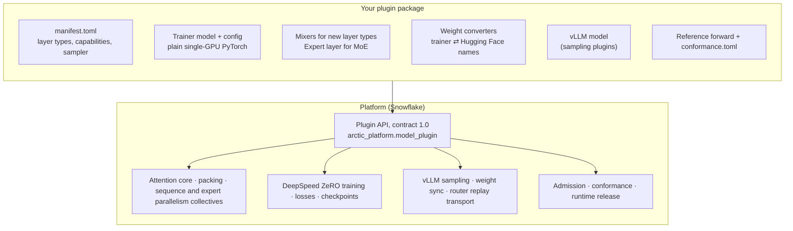
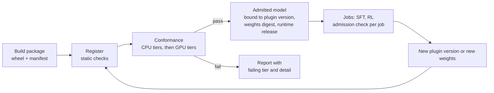
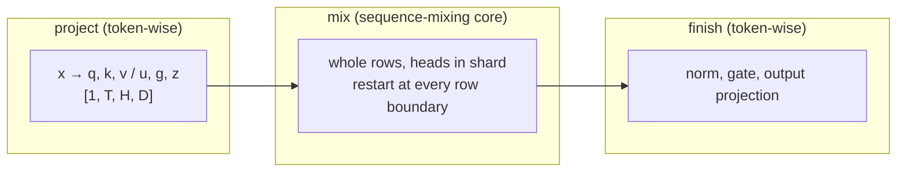
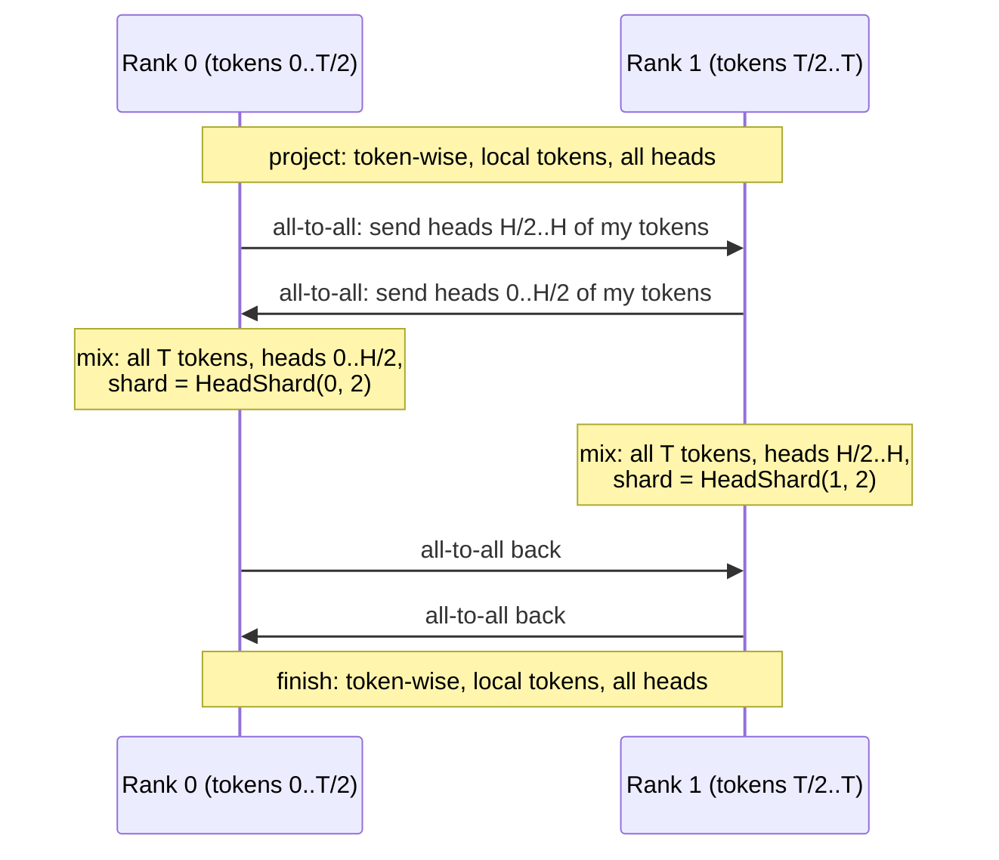
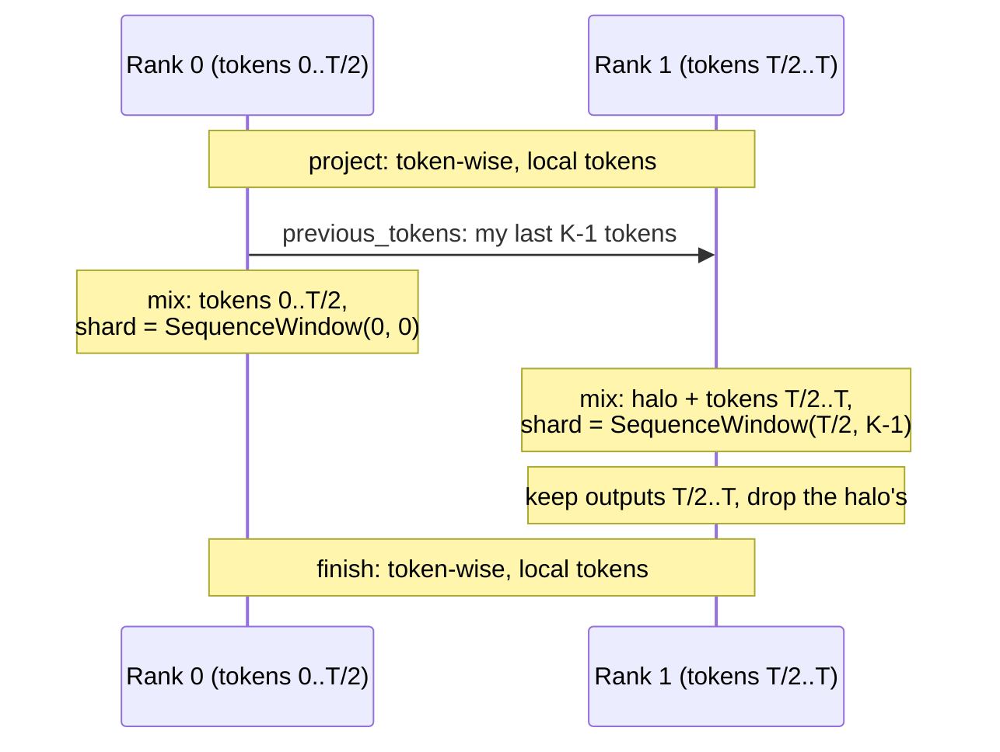
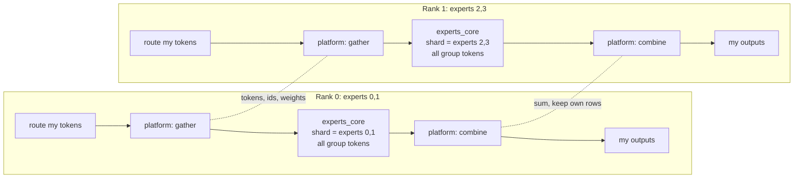
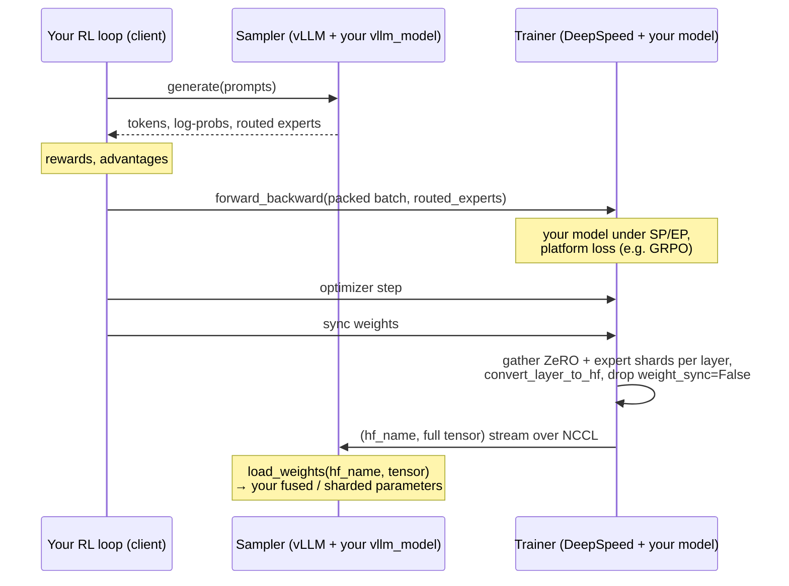
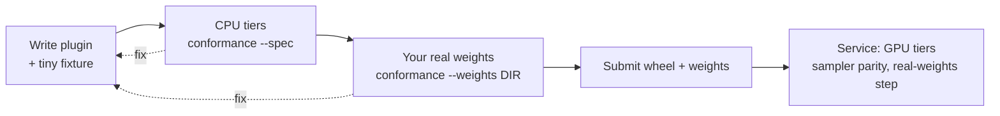
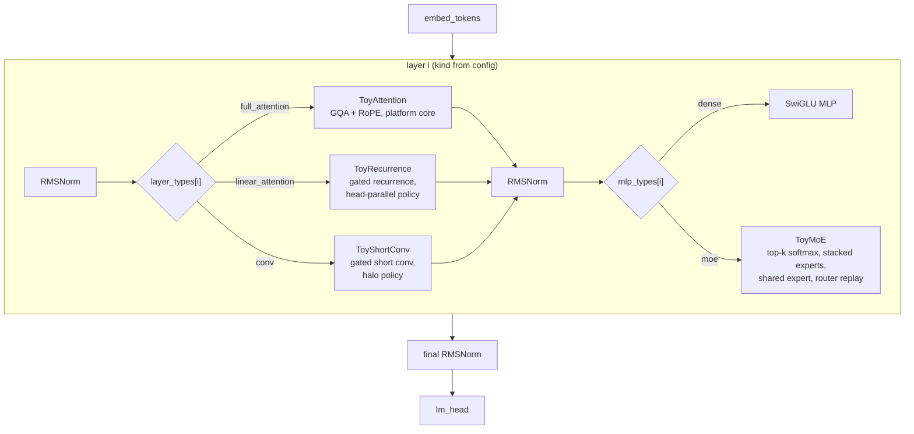

# Model plugins for Cortex Training: specification

| | |
|---|---|
| Status | **Draft for review and sign-off.** Interfaces may change until contract 1.0 is frozen. |
| Contract version | 1.1 (draft) |
| Reference implementation | [`arctic_platform/model_plugin/`](../../arctic_platform/model_plugin/) |
| Example plugin | [`examples/model_plugins/toy_hybrid_moe/`](../../examples/model_plugins/toy_hybrid_moe/) |

This document specifies how you bring a **new model architecture** to Cortex Training as a Python package, a
*model plugin*, and train it with supervised fine-tuning or reinforcement learning on the service's GPUs. It covers
what you write, what the platform does with it, the checks your plugin must pass, and what each side commits to.

The key words **MUST**, **MUST NOT**, **SHOULD** and **MAY** are used as in RFC 2119.

---

## 1. Summary

A model plugin is a Python package that describes one model family to the platform. You write the model as plain,
single-GPU PyTorch: full attention heads, full experts, no `torch.distributed`. The platform then:

- **Finds your model's structure at load time** from your config and module tree, so any layer count or layer order works without code changes.
- **Packs** several sequences into one row, **shards** sequences across GPUs (sequence parallelism) and **shards experts** across GPUs (expert parallelism), using hooks you declare.
- **Trains** it with DeepSpeed ZeRO, the platform's loss functions (SFT, GRPO and others) and its checkpointing.
- **Samples** from it with vLLM for reinforcement learning, and **syncs weights** from the trainer to the sampler after every optimizer step.

Your plugin must pass a **conformance suite** before the service admits it. You can run every CPU tier on a laptop.

---

## 2. Who owns what



| Area | You (plugin author) | Platform |
|---|---|---|
| Model math | The trainer model, its config and a slow reference implementation | Nothing. The platform never changes your math. |
| Attention | Q/K/V and output projections, positional encoding | The attention core (`AttentionModule.mix`), its GPU kernels and its sequence parallelism |
| New layer types | A sequence-mixing core (`mix`), and a `Mixer`: the policy for sharding it (default head-parallel, or your own, such as halo exchange) | The groups, and the collectives policies are built from |
| Mixture of experts | Routing and `experts_core` over stacked expert weights; an `ExpertLayer` naming them | Sharding experts, token exchange around `experts_core`, DeepSpeed gradient grouping, router-replay transport |
| Data layout | Respect packed-row boundaries (`cu_seqlens`) | Packing rows, computing boundaries, splitting sequences across ranks |
| Weights | Converters between trainer and Hugging Face names | Gathering ZeRO and expert shards, checkpoints, streaming weights to the sampler |
| Sampling | A vLLM model that loads Hugging Face-named weights | Running vLLM, sizing caches, weight-sync transport |
| Quality | A reference forward and conformance tolerances | Running conformance at registration, admission checks on every job |

---

## 3. Concepts

| Term | Meaning |
|---|---|
| **Layer type** | The kind of sequence-mixing a decoder layer does, named in the config's `layer_types` list: for example `full_attention` or `linear_attention`. |
| **Mixer** | The object that integrates one layer type with the platform: it claims the layer's modules and makes them sequence-parallel. |
| **Core (`mix`)** | The part of a sequence-mixing layer that mixes information *across tokens*. It always sees whole rows. Projections before and after it work token by token. |
| **Packed batch** | Several sequences concatenated into one row (`[1, T]`). `position_ids` restart at 0 at each row start. |
| **`cu_seqlens`** | Cumulative row boundaries of the **full, unsharded** packed batch, for example `[0, 5, 8, 16]` for rows of 5, 3 and 8 tokens. |
| **Sequence parallelism (SP)** | Each of `sp` ranks holds `T/sp` consecutive tokens. Cores exchange sequence for heads so each rank computes whole rows for `1/sp` of the heads. |
| **Head shard** | Which heads a core computes on this rank (`HeadShard(rank, size)`); `FULL_SHARD` when unsharded. |
| **Sequence window** | Which global token positions a core sees under a halo policy (`SequenceWindow(start, halo)`); `FULL_WINDOW` when unsharded. |
| **Expert parallelism (EP)** | Each of `ep` ranks holds `num_experts/ep` routed experts (`ExpertShard`) and computes them for all tokens of the group. |
| **Router replay** | In RL, the trainer reuses the expert choices the sampler made for each token, so both compute the same function. |
| **Weight sync** | After each optimizer step, the trainer streams its full weights under Hugging Face names to the sampler. |
| **Runtime release** | The frozen set of CUDA, PyTorch, DeepSpeed, transformers, vLLM and Triton versions your plugin runs against. |

---

## 4. Lifecycle



1. **Build** your package and upload the wheel together with your Hugging Face weights directory.
2. **Register** it. The service reads the manifest without importing your code, checks the contract version, checks that your dependencies are inside the runtime release, and rejects native extensions.
3. **Conformance** runs the CPU tiers on your fixture, then the GPU tiers on real weights (§9).
4. **Admitted.** The model becomes available to your account, bound to the exact plugin version, weights digest and runtime release that passed.
5. **Jobs.** Every job request is checked against your manifest and config before any GPU is allocated (§8).
6. **Updates.** A new plugin version or new weights go through registration and conformance again. Running jobs keep the version they started with.

---

## 5. Package layout

```
your-plugin/
├── pyproject.toml              # entry points (below); no dependencies outside the runtime release
├── conformance.toml            # fixture and tolerances (§9)
└── your_model/
    ├── __init__.py             # PLUGIN = ModelPlugin(...)
    ├── manifest.toml           # §6
    ├── config.py               # a transformers PretrainedConfig subclass
    ├── modeling.py             # trainer model
    ├── parallel.py             # mixers, expert layer, parallelism(config)
    ├── weights.py              # convert_layer_to_hf / convert_layer_to_prime
    ├── reference.py            # slow, independent forward for conformance
    ├── sampler_names.py        # Hugging Face name → vLLM parameter (sampling plugins)
    └── vllm_model.py           # vLLM model (sampling plugins)
```

```toml
[project.entry-points."arctic_platform.model_plugins"]
your_model = "your_model:PLUGIN"

[project.entry-points."vllm.general_plugins"]          # sampling plugins only
your_model = "your_model.vllm_model:register"
```

---

## 6. Manifest

The manifest is read **before** any of your code runs. Unknown keys are rejected.

```toml
name = "custom/acme/acme-hybrid"        # custom/<org>/<model>, lowercase
version = "0.3.1"
contract = "1.1"                         # must share the platform's major version
runtime_release = "runtime-2026.11"
hf_model_types = ["acme_hybrid"]         # config.json "model_type" values this plugin serves

[layer_types]                            # every value used in your config's layer_types
full_attention = "platform:attention"    # the platform's attention core
linear_attention = "plugin"              # your mixer, PLUGIN.mixers["linear_attention"]
conv = "plugin"                          # another plugin mixer, with its own sharding policy

[sublayer_types]                         # sequence-mixing modules inside layers (§7.3); same values
value_conv = "plugin"

[capabilities]
training = true
sampling = true
packing = true
sequence_parallel = true
expert_parallel = true
max_expert_parallel = 8
router_replay = true
peft = false

[sampler]                                # required if and only if sampling = true
vllm_architecture = "AcmeHybridForCausalLM"
vllm_plugin = "acme_hybrid.vllm_model:register"
tensor_parallel = true
speculative_decoding = false
prefix_caching = false
enforce_eager = true                     # required if a stateful layer is not a registered vLLM custom op
tokenizer_mode = "auto"                  # optional requirements: tokenizer_mode, reasoning_parser,
reasoning_parser = "acme"                # tool_call_parser, model_runner ("v1" or "v2"), and
chat_parser = "acme_hybrid.chat:AcmeChatParser"   # chat_parser ("module:Class")

[checkpoint]
layer_pattern = "^model\\.language_model\\.layers\\.(\\d+)\\."   # how checkpoint names give a decoder layer (§7.9)
passthrough = ["mtp\\.", "model\\.visual\\."]  # tensors kept in checkpoints but not loaded (§7.9)
dtype = "bfloat16"                       # train and export dtype; required for an FP8 source checkpoint

[profiles.h200-training-full]            # recommended settings, shown to users of the model
n_gpus = 16
sp_size = 4
ep_size = 8

[profiles.h200-training-full.inference]  # suggested sampler tunables; the job's inference config overrides them
tensor_parallel_size = 2
max_num_seqs = 64
```

| Field | Rule |
|---|---|
| `name` | MUST match `custom/<org>/<model>`. Unique per account. |
| `contract` | MUST have the same major version as the platform's contract. A different major version is refused. |
| `layer_types` | MUST list every value in your config's `layer_types`. Values are `platform:attention`, `plugin`, or `none` for decoder layers with no sequence mixer (an MLP or MoE block only; transformers calls such a layer `moe`). |
| `capabilities` | A job that needs an undeclared capability is rejected at admission. Declare only what passes conformance. |
| `max_expert_parallel` | Only with `expert_parallel = true`. |
| `sublayer_types` | MUST list every sub-layer type in `ParallelismInfo.sublayers`. Names MUST NOT repeat `layer_types`. |
| `sampler` | Present exactly when `capabilities.sampling = true`. Its requirements are typed fields; there is no way to set environment variables. |
| `checkpoint.layer_pattern` | Regex whose one group is a checkpoint tensor's decoder-layer index; default `^model\.layers\.(\d+)\.`. |
| `checkpoint.passthrough` | Regexes, matched at the start of a tensor name, for checkpoint tensors the trainer does not load (§7.9). |
| `checkpoint.dtype` | The dtype the model trains and exports in; required when the source checkpoint is quantized (§7.9). |
| `profiles.*.inference` | Tunables only (`tensor_parallel_size`, `max_num_seqs`, `gpu_memory_utilization`, kernel flags, `max_model_len`); a `[sampler]` requirement there is refused. |

**Layer type names.** Use names that transformers recognises: transformers 5.x validates `layer_types` against its
known kinds (`full_attention`, `sliding_attention`, `linear_attention`, `conv` and others). vLLM 0.33 sizes a hybrid
model's state caches from each stateful layer's own `MambaBase` state spec, not from these names.

---

## 7. The Python contract

A plugin hands the platform two kinds of code: **objects** it passes in the `ModelPlugin` (§7.1), and **hooks**,
methods and attributes on its own modules that the platform calls. Each hook is declared once, as a `typing.Protocol`
in `arctic_platform.model_plugin.interfaces`, with its full signature and obligations in the docstring:

| Your module | Protocol | Hooks | Required | Section |
|---|---|---|---|---|
| The trainer model | `CausalLM` | `config`, `lm_head`, `forward(input_ids, position_ids, *, cu_seqlens)` | Always | §7.2 |
| The trainer model | `ComputesLogits` | `compute_logits(hidden)` | For an output transform | §7.2 |
| A module with computed buffers | `InitializesBuffers` | `ap_init_buffers()` | If it has non-checkpointed buffers | §7.2 |
| A layer or sub-layer with a mixer | `SequenceMixingModule` | `ap_layer_type`, `mix(*tensors, cu_seqlens, shard)` | Every one; `AttentionModule` supplies `mix` | §7.3 |
| An MoE block | `RoutedModule` | `route(tokens, routed=None)` | Every expert layer | §7.6, §7.7 |
| An MoE block with stacked experts | `StackedMoEModule` | `num_experts`, `experts_core(tokens, selected, weights, *, shard)` | With `StackedExpertLayer` | §7.6 |

List the protocols a module implements as bases after `nn.Module`, as the example does:

```python
class AcmeMoE(nn.Module, StackedMoEModule): ...
class AcmeForCausalLM(nn.Module, CausalLM, ComputesLogits): ...
```

The platform checks hooks by structure at runtime, so inheriting is optional. Inherit anyway: the class declares its
role to readers, and mypy and your IDE check each hook's signature against the protocol.

### 7.1 The plugin object

```python
PLUGIN = ModelPlugin(
    manifest=load_manifest(Path(__file__).with_name("manifest.toml")),
    config_class=AcmeHybridConfig,          # transformers.PretrainedConfig subclass
    build_model=AcmeHybridForCausalLM,      # (config, options) -> trainer model, a CausalLM
    parallelism=parallelism,                # config -> ParallelismInfo
    mixers={"linear_attention": AcmeRecurrenceMixer()},
    expert_layer=AcmeExpertLayer(),         # None for dense models
    convert_layer_to_hf=convert_layer_to_hf,       # None if trainer and checkpoint tensors already match
    convert_layer_to_prime=convert_layer_to_prime,
    reference_forward=reference_forward,
    register=register_config,               # e.g. AutoConfig.register(...)
    options=AcmeOptions,                    # pydantic model of job-time options; None if there are none
    validate=validate,                      # (request, config, options) -> reasons the job cannot run
    passthrough=passthrough,                # config -> extra pass-through patterns (optional, §7.9)
)
```

**Options** are job-time choices that never change the checkpoint, such as a kernel. A job's options are validated
against `options` (an unknown option is refused) and passed to `build_model(config, options)`. **`validate`**
returns the reasons a job cannot run for constraints the manifest cannot express, typically ones that depend on an
option or the config ("`short_conv_kernel = "fused"` cannot run with sequence parallelism"). Admission reports them
with its own reasons, before any GPU is allocated.

### 7.2 The trainer model

| Requirement | Detail |
|---|---|
| Config | The model MUST keep its config as `model.config`. |
| Names | Decoder layer `i`'s parameters and buffers MUST be under `model.layers.<i>.`. Embeddings, final norm and head live outside. |
| Forward | `model(input_ids, position_ids, *, cu_seqlens)` returns the final hidden states `[1, T_local, D]`. |
| Logits | The platform turns hidden states into log-probabilities a chunk of tokens at a time, recomputing each chunk in backward: full logits of a 256K-token row over a 152K vocabulary would take ~159 GB. It calls `model.compute_logits(hidden_chunk)` if defined, else `model.lm_head(hidden_chunk)`. Override it for output transforms such as muP output scaling or logit softcapping. |
| Meta-device build | The platform builds the model on the meta device and allocates it with `to_empty`. A module whose buffers are not in the checkpoint (a rotary `inv_freq`, counters) MUST implement `ap_init_buffers()`, which recomputes them; the platform calls it on every module after `to_empty`. |
| Inputs | `input_ids` and `position_ids` are this rank's `[1, T_local]` shard of a packed batch. `cu_seqlens` describes the full batch. |
| Routing | Model code never carries routing. Each MoE module routes through its `route` method (§7.6); the platform replays and collects routing there, by decoder-layer index. |
| No distributed code | The model MUST NOT call `torch.distributed`. Use the collectives the API provides. |
| Structure from config | Layer count and layer kinds MUST come from the config, so one plugin serves every size of the family. |
| Recomputable layers | Each decoder layer MUST give the same result when it is run again in backward (§7.8). |

### 7.3 Sequence-mixing layers and mixers

Every sequence-mixing module MUST set `ap_layer_type` to its entry in the config's `layer_types`. The platform binds
each such module to that layer type's mixer, then checks the counts against the config. A module the config doesn't
account for, or a config entry with no module, fails registration, not your training run.

**Sub-layers.** A layer can contain further sequence-mixing modules, such as short convolutions on attention keys and
values. Give each its own type in the manifest's `[sublayer_types]`, set `ap_layer_type` to it, register a mixer for it
as for a layer type, and count them by type in `ParallelismInfo.sublayers`. Binding checks both counts.

Each sequence-mixing layer is split in three parts, and only the middle one sees other tokens:



**Attention** (`layer_types.<name> = "platform:attention"`). Subclass `AttentionModule`, set `num_heads`,
`num_kv_heads`, `head_dim` and optionally `sliding_window`, and call `self.mix(q, k, v, cu_seqlens=cu_seqlens)`
with `q` shaped `[1, T, H, D]` and `k`/`v` shaped `[1, T, H_kv, D]`. You MUST NOT override `mix`: the platform owns the
core, its kernels and its parallelism.

**New layer types** (`"plugin"`). Your module is a `SequenceMixingModule`: it exposes
`mix(*tensors, cu_seqlens, shard) -> tensor`, with a default for `shard` (`FULL_SHARD` or `FULL_WINDOW`), and always
calls it as `self.mix(...)`, since the platform replaces it on the instance. You register a `Mixer` for the layer type. The split of work is deliberate:

| | Owns |
|---|---|
| Your module's `mix` | The math: what the layer computes across tokens |
| Your `Mixer` | The **policy**: whether a sequence-parallel degree is legal, and how to spread `mix` over a group |
| The platform | The group, and the collectives a policy uses (`head_parallel`, `previous_tokens`, `sequence_start`, `gather_sequence`) |

Whatever the policy, `mix`:

- MUST restart all state (convolutions, recurrences, caches) at every boundary in `cu_seqlens`, which always describes the full, unsharded batch.
- MUST compute exactly what `shard` describes, slicing per-head parameters or offsetting positions to match.
- MUST NOT read tokens outside the tensors it is given, or assume it holds the first heads or the first tokens.
- MAY return `(output, *extras)` and MAY take keyword `**state`: the policy exchanges only the positional tensors and `output`, and passes `state` in and `extras` out as computed. Use them for state one layer produces and later layers reuse, such as compressed keys or a sparse-attention top-k; carry it between layers in your model code, as layer outputs and inputs, so activation checkpointing saves and recomputes it correctly. State and extras are in the policy's own shard layout (under head-parallel, this rank's heads over the whole sequence), so the producing and consuming layers MUST use the same policy. A reduction across all heads, such as a top-k over every indexer head, cannot be computed from one rank's heads: give such layers a local-query or gather policy (`gather_sequence`).

The `shard` argument's type is set by the layer's policy. Two policies ship today:

| Policy | Use it when | `mix` receives | `shard` | Mixer to register |
|---|---|---|---|---|
| **Head-parallel** (default) | Heads are independent inside the core: attention, recurrences, state-space layers | All `T` tokens of `1/sp` of the heads, head-major `[1, T, H_i/sp, D_i]` | `HeadShard(rank, size)`; slice per-head parameters with `shard.local(num_heads)` | `HeadParallelMixer` subclass naming your module class. It checks every head count in `ParallelismInfo.heads[layer_type]` divides by `sp_size`. |
| **Halo** (custom) | The core reads a short, fixed window of earlier tokens: short and causal convolutions | Its own `T/sp` tokens plus a halo of the previous rank's last tokens, `[1, halo + T/sp, C]` | `SequenceWindow(start, halo)`: the tensors cover global positions `[start - halo, start + T/sp)`. `mix` returns outputs for all of them; the mixer keeps the non-halo part. | Your own `Mixer`. Its `apply_sequence_parallel` wraps `mix` using `previous_tokens` and `sequence_start`; its `validate_sp` has no head constraint. |

A core whose positions interact across the whole sequence can use `gather_sequence(group, tensor)`: every rank gets the
whole sequence, and in backward each rank's gradient for it is summed in fp32 and sliced back to its owner.

Halo exchange moves only `halo` tokens per rank instead of every activation twice, and never splits channels, so any
sequence-parallel degree works as long as each shard holds at least `halo` tokens. The example's `ShortConvMixer`
is a complete implementation in about 15 lines. Other policies, such as gathering the full sequence for a core whose
heads interact, are written the same way.

### 7.4 Parallelism info

```python
def parallelism(config) -> ParallelismInfo:
    return ParallelismInfo(
        layer_types=tuple(config.layer_types),                      # one per decoder layer
        sublayers={"value_conv": config.layer_types.count("full_attention")},  # sub-layer modules by type
        heads={"full_attention": (config.num_attention_heads, config.num_key_value_heads),
               "linear_attention": (config.linear_num_heads,)},     # every head count a core exchanges
        moe_layers=tuple(i for i, kind in enumerate(config.mlp_types) if kind == "moe"),
        num_experts=config.num_experts,
        top_k=config.num_experts_per_tok,
    )
```

### 7.5 Sequence parallelism

With `sp_size = 2`, each rank holds half of the packed tokens. For every sequence-mixing layer the platform does
this around your core:



Requirements: every head count your core exchanges MUST divide by `sp_size`, which admission checks. The packed
length MUST divide by `sp_size`; the platform pads to make it so.

A halo policy instead keeps every rank on its own tokens and borrows only the tokens its window reaches back to:



In backward, the gradient of the borrowed tokens flows back to the rank that owns them.

### 7.6 Mixture of experts and expert parallelism

MoE follows the same split as mixers: your module owns the math, your `ExpertLayer` declares the policy, and the
platform moves tokens. Model code never calls a collective and never tracks which experts it holds.

Your MoE module MUST be a `StackedMoEModule` (or, with your own `ExpertLayer`, at least a `RoutedModule`):

- have a `num_experts` attribute, and store routed expert weights **stacked with the expert index as dim 0**, named in `StackedExpertLayer.expert_names`. The platform MoE layout is `w1` (gate) and `w3` (up) `[E, I, D]`, `w2` (down) `[E, D, I]`; a gateless expert (for example relu²) has only `w1` and `w2`;
- route through one method, `route(tokens, routed=None, ...) -> (selected [N, top_k], ...)`, called once per forward on all of the layer's local tokens; it picks experts with `choose_experts(scores, top_k, routed)` and returns the selection first. Extra arguments are passed through (for example `input_ids` for a hash-routed layer); `routed` is the platform's to supply. Its forward calls `self.route(tokens)`, then `self.experts_core(tokens, selected, weights)`, and adds any shared expert;
- be the only expert layer in its decoder layer;
- implement `experts_core(tokens [N, D], selected [N, top_k], weights [N, top_k], *, shard: ExpertShard | None = None) -> [N, D]`: the summed contribution of the experts `shard` holds, where local expert `i` is global expert `shard.start + i`. With `shard=None` it holds them all.

```python
def forward(self, x):
    tokens = x.reshape(-1, x.shape[-1])
    selected, weights = self.route(tokens)                    # the platform supplies `routed` when replaying
    out = self.experts_core(tokens, selected, weights) + self.shared_expert(tokens)
    return out.view_as(x)

def route(self, tokens, routed=None):
    scores = torch.softmax(self.gate(tokens.float()), dim=-1)
    selected = choose_experts(scores, self.top_k, routed)      # replayed ids win; -1 entries route freshly
    weights = scores.gather(1, selected)
    return selected, weights / weights.sum(-1, keepdim=True)

def experts_core(self, tokens, selected, weights, *, shard=None):
    shard = shard or ExpertShard.full(self.num_experts)
    out = torch.zeros_like(tokens)
    for local in range(shard.per_rank):                        # only the experts this rank holds
        rows, slots = (selected == shard.start + local).nonzero(as_tuple=True)
        ...                                                    # expert `local` on tokens[rows], weighted
    return out
```

Register a `StackedExpertLayer` naming the module class and its stacked tensors:

```python
class AcmeExpertLayer(StackedExpertLayer):
    module_class = AcmeMoE
    expert_names = ("experts.w1", "experts.w2", "experts.w3")
```

Under expert parallelism the platform keeps each rank's block of experts, then wraps `experts_core`:



| `ExpertLayer` member | Called by | `StackedExpertLayer` does |
|---|---|---|
| `is_instance(module)` | Binding | `isinstance(module, module_class)`. The count MUST match `ParallelismInfo.moe_layers`. |
| `num_experts(module)` | `prepare_model`, before sharding | `module.num_experts` |
| `expert_parameters(module)` | `prepare_model`, before and after sharding | The tensors in `expert_names` |
| `apply_expert_parallel(module, group)` | `prepare_model` | `expert_parallel(...)`: shard the stacked tensors and wrap `experts_core` |

After `apply_expert_parallel`, the platform verifies each expert tensor holds `num_experts / ep` experts and tags it
so DeepSpeed reduces its gradients over the expert-data-parallel group, and so export gathers it back. DeepSpeed
recognises only its own MoE module class, so the platform declares your expert layers to it when it builds the
training engine (`initialize_deepspeed`); ZeRO-3 is not supported together with expert parallelism. Routing,
shared experts and any router bias stay replicated. Write your own `ExpertLayer` only for a different dispatch
policy; the platform can likewise replace the token exchange behind `experts_core`, for example with DeepEP's
all-to-all on GPU, without changing your model code.

On GPU the platform's own MoE layer, with DeepEP/UCCL dispatch, grouped GEMM and SonicMoE kernels, uses the same
stacked layout and router-replay semantics. A plugin whose routing it can express SHOULD use it. The example plugin
carries its own small MoE so that it runs on CPU.

### 7.7 Router replay

During RL the sampler records, for every token and expert layer, the experts it chose. The trainer then replays
them so both compute the same function. The platform wraps each MoE module's `route` method
(`RoutedModule`) and passes the sampler's ids for that layer as `routed`; a
token whose id is `ROUTER_REPLAY_FRESH` (`-1`, no capture) is routed by the module's own choice. `choose_experts`
implements both. The platform also reads back the experts every layer chose. Binding fails if a claimed MoE module
has no `route(tokens, routed=None)`.

On the sampler, routing is captured automatically when your vLLM model routes its experts through vLLM's fused MoE
layer (`FusedMoEFactory`). A custom vLLM router MUST feed vLLM's routed-experts capture, or the manifest MUST declare
`router_replay = false`. vLLM 0.33 captures routing only with its V2 model runner and prefix caching on, so a sampler
that offers router replay MUST declare `prefix_caching = true` and pass the sampler tier with it; the platform then
launches router-replay jobs with both. For stateful layers, prefix caching means "align"-mode state caching: vLLM keeps
state per block and copies it between blocks itself, so a layer reads and writes only each request's current block
(`state_indices[:, 0]`) and resumes when `has_initial_states_p` is set. Without prefill checkpoints
(`MambaBase.get_prefill_checkpoint_alignment`), a prompt that shares only part of a cached prompt resumes only from a
state vLLM saved within the shared part, at a block boundary it wrote when its own chunk ended; with none, the prompt is
recomputed.

### 7.8 Activation checkpointing

To fit long sequences, the platform checkpoints every decoder layer (`model.model.layers[i]`): it keeps only the
layer's inputs and runs the layer again during backward. Your layers therefore run twice per step.

- A layer's forward MUST be a function of its inputs and weights. Recompute reruns the sequence and expert collectives, which is supported.
- Side effects, such as counting tokens per expert or updating running statistics, MUST run only on the first pass: guard them with `if not in_recompute()`.
- Randomness, such as dropout, MUST draw the same values on recompute. PyTorch's checkpoint restores the RNG state for you.
- **Routing is replayed, not recomputed.** Nondeterministic kernels (split-K matmuls, all-to-all reductions) can perturb router scores in the last bits, so a recomputed `topk` could pick other experts: a `CheckpointError`, or silently wrong gradients. The platform records the experts each `route` call chose in that checkpointed call's own frame and passes them as `routed` on its recompute, so pending forwards and gradient accumulation never consume another forward's routing. This covers SFT, RL without replay, and fresh (`-1`) tokens.

The `activation_checkpointing` conformance tier compares outputs, gradients **and buffers** with and without
checkpointing, so a side effect that runs twice fails it.

### 7.9 Weights and checkpoints

The canonical on-disk format is a Hugging Face directory. Users bring weights in this format and receive checkpoints
in it.

| File | Requirement |
|---|---|
| `config.json` | `model_type` in the manifest's `hf_model_types`; `architectures[0]` equal to `sampler.vllm_architecture`; loads with your `config_class.from_pretrained`. |
| `model.safetensors`, or `model-0000k-of-0000n.safetensors` plus `model.safetensors.index.json` | Tensors under Hugging Face names. Large models MUST be sharded; the index maps every tensor to its file. |
| `tokenizer.json`, `tokenizer_config.json`, special-token files | MUST load with `AutoTokenizer.from_pretrained(path, trust_remote_code=False)`, define an EOS token, and have no more tokens than the model's vocabulary. A chat model SHOULD carry its `chat_template`; the sampler and chat endpoints use it. |
| `generation_config.json` | Optional default sampling settings. |

Conversion and loading:

- `convert_layer_to_hf(state, layer_idx, config)` receives one decoder layer's full tensors under trainer names and returns them under checkpoint names. It MAY rename, split, stack and reshape. `convert_layer_to_prime` is its exact inverse. Both receive the config, because reshaping often needs head counts the tensors don't carry. Both are also called with `layer_idx = -1` for the tensors outside decoder layers (embeddings, final norm, head); don't index per-layer config lists with it, since Python reads `-1` as the last layer.
- **Checkpoint naming.** Trainer names are always `model.layers.<i>.…`. Checkpoint names are your converters' choice; the manifest's `[checkpoint] layer_pattern` tells the platform which decoder layer a checkpoint tensor belongs to, for checkpoints such as `model.language_model.layers.<i>.…`, `backbone.layers.<i>.…` or prefix-less `layers.<i>.…`. Loading refuses names that look like decoder-layer tensors (`layers.<n>.`) but match no layer, since a wrong pattern would otherwise load the whole model as one group.
- **Quantized source checkpoints.** A checkpoint that stores FP8 (or uint8-packed, such as MXFP4) tensors loads only with `[checkpoint] dtype` declared: `convert_layer_to_prime` dequantizes each layer, consuming its scale tensors, and the model trains and exports in that dtype. Exports never carry `quantization_config`. The trainer does not keep quantized weights (frozen FP8 bases are out of scope with LoRA, §13).
- The platform loads a checkpoint **one decoder layer at a time**, reading only that layer's tensors from disk, so converters see one layer and peak extra memory is one layer. Every trainer tensor MUST be set and no checkpoint tensor may be left over.
- The platform gathers ZeRO and expert shards before calling your converter on export, so converters always see full tensors.
- **Pass-through tensors.** Checkpoint tensors your trainer does not use, such as multi-token-prediction heads or a vision tower when training text, are declared as regexes in the manifest's `[checkpoint] passthrough` (matched at the start of the name). They are not loaded, do not count toward the checkpoint's dtype, are copied unchanged into every exported checkpoint, and never reach the sampler. Patterns that depend on the config, such as MTP layers stored after the last decoder layer at `model.layers.{num_hidden_layers + k}`, come from the plugin's `passthrough(config)`. Any other checkpoint tensor the model does not account for is still refused.
- Checkpoints the platform writes carry a **plugin stamp** in their safetensors metadata (`arctic_plugin`, `arctic_plugin_version`, `arctic_plugin_contract`). A checkpoint stamped by a different plugin is refused at load. A different version of the same plugin loads and is logged.
- **Dtypes.** Store weights in the dtype you want served, usually bf16. The platform builds your model in `[checkpoint] dtype` if declared, else in the dtype that holds most of a checkpoint's elements, before loading it, so a save and reload is exact. The trainer computes in the job's dtype and keeps fp32 master weights in the optimizer. Tensors that must stay fp32, such as routers or statistics, are marked `dtype="fp32"` (below); checkpoints and the weight stream then carry mixed dtypes.

**Marks.** `mark(tensor_or_module, **properties)` is the one way to tell the platform how to treat a tensor. A mark on a
module applies to all its tensors; a deeper module's, then the tensor's own, overrides it. Prefer marking modules: the
platform carries a tensor's own mark through its build, load and expert sharding, but not through tensors your code
replaces, and moving a model between devices replaces buffer objects.

| Property | Effect | Read when |
|---|---|---|
| `dtype="fp32"` | Stays fp32 when the model is cast to bf16 (feeds the platform's keep-fp32 flag) | Casting the model's dtype |
| `weight_sync=False` | Kept in checkpoints, left out of the stream to the sampler. `skip_weight_sync(x)` is an alias. | Streaming weights |
| `weight_decay` | Whether the optimizer's weight decay applies; by default to parameters with two or more dimensions | Building optimizer groups |
| `lora_target=True` | Modules only: gets LoRA adapters, named for vLLM through your Hugging Face-to-vLLM name map. Recorded now; plugin LoRA is not supported yet (§13). | Setting up LoRA |
| `frozen=True` | Not trained | Building optimizer groups |

### 7.10 RL step and weight sync



Your vLLM model's `load_weights` is the weight-sync entry point. It MUST accept full, unsharded Hugging Face-named
tensors one at a time, write them into its tensor-parallel shards through each parameter's `weight_loader`, and return
the names of the parameters it wrote. We recommend a pure function mapping a Hugging Face name to its vLLM
destination, as in `sampler_names.py`, which CPU tests can check against the trainer's stream.

### 7.11 The sampler (vLLM) model

| Requirement | Detail |
|---|---|
| Registration | Through the `vllm.general_plugins` entry point, calling `ModelRegistry.register_model` with a lazy `"module:Class"` path. |
| Architecture | `config.json` `architectures[0]` MUST equal `sampler.vllm_architecture`. |
| Interfaces | Standard vLLM model API: `__init__(*, vllm_config, prefix)`, `forward`, `compute_logits`, `load_weights`. Hybrid models implement `IsHybrid` and `HasInnerState` with their state shapes and dtypes. |
| Stateful layers | Subclass vLLM's `MambaBase`. A layer that is not registered as a custom op MUST run with `enforce_eager = true`. |
| Tensor parallelism | Declared with `sampler.tensor_parallel`. Shard by heads and intermediate size with vLLM's parallel linear layers. |
| Features | `speculative_decoding` and `prefix_caching` MUST stay `false` until the sampler tier passes with them on. Stateful layers are the usual reason they fail. |
| Version | The vLLM model is valid only for the vLLM in its runtime release. |
| Patching | It MUST NOT patch vLLM or another plugin. |

---

## 8. Admission

Every job is checked before GPUs are allocated. All failing reasons are reported together.

| Request | Rejected when |
|---|---|
| `job_type = training` / `sampling` | The capability is not declared, or there is no `[sampler]` table |
| `sp_size > 1` | `sequence_parallel` not declared, or any layer type's head counts are not divisible by `sp_size` |
| `ep_size > 1` | `expert_parallel` not declared, the config has no expert layers, `num_experts % ep_size != 0`, or `ep_size > max_expert_parallel` |
| `peft` | `peft` not declared |
| `router_replay` | `router_replay` not declared, or the config has no expert layers |
| `options` | An option the plugin does not declare, a value its options model rejects, or a reason from the plugin's `validate` |
| Sampler `tensor_parallel_size > 1`, `speculative_config`, `enable_prefix_caching` in the job's inference config | The matching `[sampler]` flag is not set |
| Any `[sampler]` requirement in the job's inference config | Its value differs from the manifest's |
| Sampling with `router_replay` | The sampler does not declare `prefix_caching`, the job turns prefix caching off, or the sampler requires the V1 model runner |

**Launching the sampler.** Engine settings are the job's profile's `inference` defaults, overridden by the job's
inference config (admission checks the two together), with the `[sampler]` requirements applied last
(`sampler_launch`). `model_runner` and `chat_parser` are set only by the manifest. Prefix caching is on only when
`[sampler] prefix_caching = true`: vLLM turns it on by default, and for a model with stateful layers that silently
switches state caching to a mode those layers may not implement.

---

## 9. Conformance

```mermaid
flowchart LR
    S["static"] --> R["reference parity"] --> K["packing · log-prob<br/>chunking"] --> A["activation<br/>checkpointing"] --> M["meta build ·<br/>dtype marks"] --> W["checkpoint and sync"]
    W --> L["RL step"] --> Q["router replay"] --> P["SP · EP · SP+EP<br/>(gloo ranks)"]
    P --> D["weights directory<br/>(real weights, meta device)"]
    D --> G1["sampler log-prob parity<br/>(GPU, vLLM)"] --> G2["real-weights step<br/>(GPU)"]
    classDef gpu stroke-dasharray: 4 3
    class G1,G2 gpu
```



Run every CPU tier locally, or add `--device cuda` to run the same tiers on GPUs (the parallel tiers then use one
GPU per rank over NCCL):

```bash
python -m arctic_platform.model_plugin.conformance --plugin your_model:PLUGIN --spec conformance.toml
```

Each tier reports `PASS`, `FAIL` or `SKIP`. The `rl_step` tier uses the platform's GRPO loss and is skipped
unless `arctic-platform[rl]` is installed; the service always runs it. `reference_forward` runs on the fixture's
device, so allocate its tensors on the input's device.

| Tier | Passes when | Catches |
|---|---|---|
| static | The manifest is on contract, mixers resolve, and the fixture model binds to its config | Undeclared layer types, missing mixers, modules the config does not account for |
| reference parity | Model logits on each unpacked row equal `reference_forward` within `reference` | Wrong math |
| packing | Packed rows give the same logits **and gradients** as each row run alone | State leaking across row boundaries |
| log-prob chunking | Log-probs computed `logprob_chunk` tokens at a time, through `compute_logits`, equal one pass over the row, values and gradients, within `chunking` | A `compute_logits` that is not token-wise, chunk-boundary bugs |
| activation checkpointing | With every decoder layer checkpointed, logits, gradients and buffers are unchanged | Side effects that run twice, non-recomputable layers |
| meta build | Built on the meta device, `to_empty`, `ap_init_buffers` and loaded from a checkpoint, every buffer and the logits equal a normal build exactly | Non-checkpointed buffers left uninitialized |
| dtype marks | Under a bf16 build, `dtype="fp32"` tensors stay fp32 and the rest are bf16; the weight stream and a checkpoint carry the mixed dtypes and reload exactly | Marks lost on cast, dtype-unsafe export or load |
| checkpoint and sync | Single-file and sharded save → reload reproduce logits exactly; the checkpoint carries this plugin's stamp; the sampler stream equals the checkpoint minus skipped tensors | Lossy or asymmetric converters, broken sharding, missing tensors |
| RL step | A GRPO step (the platform's `grpo_loss`) on packed rows equals the same step on padded rows, for loss and every gradient | Masking and packing bugs in the training path |
| router replay | Replaying captured routing reproduces logits exactly; all-`ROUTER_REPLAY_FRESH` does too; forcing other experts changes the output | A router that ignores replay |
| SP, EP, SP+EP | On 2+ gloo ranks, sharded logits and every gradient equal the unsharded model's. Under EP, the exported weight stream equals the unsharded model's. SP+EP runs with activation checkpointing on. | Wrong head slicing, a missing or wrong halo, global vs local boundaries, wrong expert offsets, missing gradient paths, expert shards exported out of order, collectives that break under recompute |
| weights directory (`--weights`) | Your real weights directory has a matching config, every tensor with the model's name and shape (checked on the meta device, so no GPU or full load), and a tokenizer that loads without remote code | Truncated or mismatched checkpoints, missing index shards, tokenizer problems |
| sampler log-prob parity (GPU) | After a weight sync, sampler log-probs match trainer log-probs within the calibrated tolerance | Wrong vLLM name map, fused-shard order, sampler numerics |
| real-weights step (GPU) | One training step on your real weights and declared profile, save, and reload | Memory and scale issues the tiny fixture hides |

**Tolerances.** All comparisons use `rtol = 0` and an absolute tolerance from `conformance.toml`. CPU tiers run in fp32
on a tiny fixture, where `1e-5` is typical; justify anything looser in the file. GPU tolerances are calibrated per
plugin at registration and recorded with the admitted version.

```toml
seed = 0
sequence_lengths = [5, 6, 5]   # packed rows; the total must divide by every sp size, and a row must cross each
                               # shard boundary so state carried from the previous rank is exercised
sp_sizes = [2]
ep_sizes = [2]
logprob_chunk = 4              # tokens per log-prob chunk: short, so rows span several chunks
# options = { kernel = "fast" }  # the plugin's job options for the fixture, if any

[fixture]                      # kwargs for your config class: tiny, but with every layer and MLP kind
vocab_size = 64
hidden_size = 32
layer_types = ["linear_attention", "full_attention", "conv", "full_attention"]
mlp_types = ["dense", "moe", "moe", "dense"]

[tolerances]
reference = 1e-5
packing = 1e-5
parallel = 1e-5
rl_step = 1e-5
chunking = 1e-6                # chunking reorders the output projection's gradient sum: fp32 rounding, not bitwise
```

A failing tier prints its name and the first mismatch, for example
`sp2  FAIL  sp logits: shapes (1, 8, 64) vs (1, 8, 64), max |diff| 0.41`.

---

## 10. Testing locally

Everything before the GPU tiers runs on a laptop with only `arctic_platform`, PyTorch, transformers and safetensors
installed, except the `rl_step` tier, which needs `arctic-platform[rl]` and is skipped without it. Sequence and
expert parallelism run as separate CPU processes over gloo.



| Step | Command | Needs |
|---|---|---|
| 1. Contract and math on a tiny model | `python -m arctic_platform.model_plugin.conformance --plugin your_model:PLUGIN --spec conformance.toml` | CPU only; under a minute for a tiny fixture |
| 2. Your real weights, structurally | the same command with `--weights /path/to/hf_dir` | CPU only: tensor shapes are read from safetensors headers and checked on the meta device, so a 100B+ checkpoint needs no GPU and is not loaded into memory |
| 3. Unit tests for your own code | `pytest` against your package, for example converters and the `sampler_names` mapping (the repository's `tests/model_plugin` shows how) | CPU only |
| 4. Sampler and scale | submit; the service runs the GPU tiers and reports them like the CPU tiers | Service GPUs |

We recommend a pure Hugging Face-name → vLLM-parameter function, as in the example's `sampler_names.py`, so step 3
can prove every tensor the trainer streams has exactly one destination before any GPU is involved.

---

## 11. Runtime constraints

| Rule | Why |
|---|---|
| Dependencies MUST be satisfied by the runtime release. Pure-Python and Triton code are allowed; precompiled CUDA extensions are not. | The image is fixed and scanned; your wheel is installed without network access. |
| Your code runs in a sandbox with no network egress. | Isolation between customers. |
| No `torch.distributed` calls in model code; use the API's collectives. | The platform owns process groups and their layout. |
| No monkeypatching of the platform, DeepSpeed, transformers, vLLM or another plugin. | Several components share one process. |
| Forward passes MUST be deterministic given inputs and weights, apart from documented kernel nondeterminism. | Conformance and RL parity depend on it. |

---

## 12. Versioning and support

- **Contract.** The platform supports plugins whose `contract` has its major version. Once 1.x is frozen, minor versions add optional fields and hooks only, and a major version change is announced in advance, with a migration guide. Until then, draft revisions may change interfaces: draft 1.1 makes the forward return hidden states (`compute_logits`) and moves routing out of model code (`route`, `choose_experts`), and adds the meta-device build (`ap_init_buffers`), `mark`, plugin options, sub-layers, `mix` extras for cross-layer state, mixer-less layer types, typed sampler requirements, checkpoint naming, quantized source checkpoints and pass-through checkpoint tensors.
- **Runtime release.** A plugin is admitted against one runtime release and keeps running on it while that release is supported. Moving to a newer release re-runs conformance.
- **Support window.** The number of runtime releases supported in parallel, and their deprecation notice, will be fixed before contract 1.0.
- **Failure attribution.** A job that fails inside plugin code is reported as a plugin failure with the stack trace. Failures in platform code are the platform's. Conformance results define the supported envelope: a configuration outside the declared capabilities is rejected, not attempted.

---

## 13. Not in scope for contract 1.0

- Tensor parallelism in the trainer. Training parallelism is ZeRO data parallelism, sequence parallelism and expert parallelism.
- Pipeline parallelism, multimodal encoders, and custom optimizers or loss functions inside the plugin.
- ZoRRo prompt deduplication and other model-specific trainer patches.
- LoRA for plugin models (`peft`). The flag exists, but no conformance tier covers it yet.
- CUDA graphs for plugin stateful layers in vLLM, unless they are registered as custom ops.

---

## 14. Worked example: ToyHybridMoE

[`examples/model_plugins/toy_hybrid_moe`](../../examples/model_plugins/toy_hybrid_moe/) is a complete plugin that
touches every part of this contract. The architecture is new to the platform:



| Contract part | Where it lives |
|---|---|
| Manifest, capabilities, sampler | `toy_hybrid_moe/manifest.toml` |
| Config-driven structure | `config.py` (`layer_types`, `mlp_types`) |
| Platform attention | `modeling.ToyAttention(AttentionModule)` |
| New layer type, default policy | `modeling.ToyRecurrence.mix` (row restarts, head slicing); `parallel.GatedRecurrenceMixer` |
| New layer type, custom policy | `modeling.ToyShortConv.mix` (global positions from `SequenceWindow`); `parallel.ShortConvMixer` (halo exchange) |
| MoE, EP and router replay | `modeling.ToyMoE` (`route` with `choose_experts`, `experts_core`); `parallel.ToyExpertLayer` (a `StackedExpertLayer`) |
| Marks, meta-device build | `modeling.LoadStats` (`dtype="fp32"`, `weight_sync=False`); `modeling.RotaryEmbedding` (`dtype="fp32"`, `ap_init_buffers`); the fp32 router |
| Output transform | `ToyHybridMoEForCausalLM.compute_logits` (optional logit softcapping) |
| Sub-layer, options | `modeling.ToyValueConv` (`[sublayer_types] value_conv`); `options.ToyOptions` and `parallel.validate` |
| Hugging Face conversion | `weights.py`: per-expert keys, `mlp.gate`, `Conv1d` layout |
| Reference oracle | `reference.py`: explicit attention, loops, per-token experts |
| Sampler | `vllm_model.py`, `sampler_names.py` |
| Conformance | `conformance.toml` |

Its CPU conformance run:

```text
static                    PASS
reference_parity          PASS
packing                   PASS
logprob_chunking          PASS
activation_checkpointing  PASS
meta_build                PASS
dtype_marks               PASS
checkpoint_and_sync       PASS
rl_step                   PASS
router_replay             PASS
sp2                       PASS
ep2                       PASS
sp2+ep2                   PASS
```

The test suite also feeds conformance deliberately broken variants and checks that the right tier rejects each one:

- a recurrence that ignores row boundaries;
- statistics counted again on recompute;
- rotary frequencies not recomputed after a meta-device build;
- a router that ignores replay;
- a lossy converter;
- a convolution that ignores row boundaries;
- an SP rank slicing the wrong heads;
- a halo mixer that never borrows the previous rank's tokens;
- an `experts_core` that treats its local experts as experts 0 onward;
- weights directories with a missing tokenizer, a mismatched config or a foreign `model_type`;
- a checkpoint stamped by another plugin.

---

## 15. Sign-off checklist

**Plugin author**

- [ ] The manifest declares only capabilities that pass conformance.
- [ ] Every value in the config's `layer_types` is in the manifest, and every sequence-mixing module sets `ap_layer_type`.
- [ ] Cores restart at row boundaries and compute exactly what `shard` describes: heads for head-parallel, global positions for halo.
- [ ] Every plugin layer type has a mixer whose policy fits its core; custom policies use only the platform's collectives.
- [ ] Expert weights are stacked on dim 0, `experts_core` offsets by `shard.start`, and routing goes through `route(tokens, routed=None)` with `choose_experts`.
- [ ] Decoder layers are recomputable; side effects are guarded with `in_recompute()`.
- [ ] The weights directory passes `--weights`: matching config, sharded safetensors with an index, and a tokenizer with EOS and a chat template.
- [ ] The converters are exact inverses, and trainer-only state is marked `weight_sync=False`.
- [ ] The forward returns hidden states; any output transform is in `compute_logits`.
- [ ] Every non-checkpointed buffer is recomputed by its module's `ap_init_buffers()`.
- [ ] The vLLM `load_weights` accepts Hugging Face-named full tensors and returns the parameters it wrote.
- [ ] `reference_forward` is independent of the trainer code.
- [ ] All CPU tiers pass locally; tolerances are `rtol = 0` with justified `atol`.
- [ ] Dependencies are within the runtime release; there are no native extensions and no monkeypatching.

**Snowflake**

- [ ] The CPU and GPU tiers passed on the submitted wheel, weights digest and runtime release.
- [ ] The admitted version and its calibrated GPU tolerances are recorded.
- [ ] Admission enforces the manifest's capabilities for every job.
- [ ] The runtime release's support window is communicated.

---

## 16. Open questions for review

1. Should a plugin be allowed to use the platform's GPU MoE layer directly through the API, so customers get its grouped GEMM and SonicMoE kernels as well as DeepEP dispatch behind `experts_core`?
2. Which GPU tolerance policy suits RL customers best for sampler log-prob parity: a fixed bound, or calibration against a known-good model of similar size?
3. Should `peft` (LoRA) get its own conformance tier in 1.0, including expert LoRA?
4. Is a per-plugin `max_sequence_length` or memory profile needed in the manifest for admission, beyond `profiles`?
5. Should the contract ask stateful sampler layers for prefill checkpoints (`MambaBase.get_prefill_checkpoint_alignment`), so prompts that share only part of a cached prompt hit the cache (§7.7)?
6. Should the plugin kit ship a local GPU smoke test (load in vLLM, sync weights, compare trainer and sampler log-probs) and let Arctic Platform's on-prem trainer run plugin models, so customers can test the GPU tiers before submitting?
